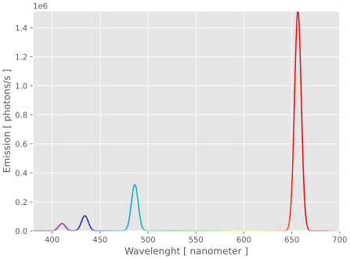

---
hide:
  - navigation
---
# Jablonski
<div class="grid cards" markdown>

- { align=left , width="375" } 
```py
from jablonski.plots import graph_spectra

fig, ax = graph_spectra(
    Hydrogen,
    [
        Hydrogen.absorption_1,
        Hydrogen.absorption_2,
        Hydrogen.absorption_3,
        Hydrogen.absorption_4,
    ],
    height=1e8/(u.cm**2 *u.s),
)
```
</div>
<div style="text-align:center;">  Spectra from simplified hydrogen model in Jablonski. Widths are arbitrary. </i></div>
Jablonski is a Python-based package for simulation of photochemical systems. It extends [Poincare](https://github.com/dyscolab/poincare), a package for modelling dynamical systems. It's designed around:

- __Modularity__: Jablonski is intended to create a layer to separate the actual declaration and simulation of models, allowing to easily switch between methods and compile to different backends (including [NumPy](https://numpy.org/) [Numba](https://numba.pydata.org/) and [JAX](https://docs.jax.dev/en/latest/)). 

- __Composability__: models are composable, allowing for the combination of smaller systems to create larger ones; complex models can be broken up into more manageable parts.

- __Reproducibility__: it intends to be a centralized place for all information concerning models, making it easy to extract data about information and parameters and encouraging consistency between analytical formulations and numerical implementations.

- __Utility__: Jablonski contains a number of simulation and analysis tools, such as piecewise simulation for pulse excitations and getting a system's time resolved and steady state emission spectra.

---
## Installation


It can be installed from PyPI:

```sh
pip install -U jablonski
```

or conda-forge:

```sh
conda install -c conda-forge jablonski
```

### Agent skill

Jablonski ships with the `dyscolab-modeling` agent skill, which teaches coding agents how to use Poincare, SimBio and Jablonski. It is downloaded with the library, but has to be added to your agent's skills folder separately.


In pixi projects, link it with [pixi skills](https://pixi.prefix.dev/dev/integration/extensions/pixi_skills/), so it updates together with the library:

```sh
pixi global install pixi-skills                   # once
pixi skills manage --backend claude --scope local  # or another agent's backend
```

In any other environment, copy it with the environment's Python, and run the command again after upgrading the library:

```sh
python -m poincare.skill install --dest .agents/skills   # or .claude/skills, ~/.codex/skills, ...
```

See [Agent skills](skills.md) for more details.

---
## Documentation
Documentation is structured as a series of interactive [marimo](https://marimo.io/) notebooks which cover basic and advanced topics. They can be ran in the browser either in a static or interactive version or by cloning the [dyscolab-tutorials](https://github.com/dyscolab/dyscolab-tutorials) repository to open them locally. For more information, see [Poincare's documentation](poincare.md#documentation).
### Basics
- **Getting started with Jablonski**: the essentials necessary to use Jablonski. [Interactive](https://marimo.app/https://github.com/dyscolab/dyscolab-tutorials/blob/main/jablonski/getting_started_with_jablonski.py) / [Static](static_notebooks/getting_started_with_jablonski.html)
### Topic guides
- **Emission, absorption and quantum yield**: compute spectroscopic observables, including emitted and absorbed photons over time, steady-state spectra and quantum yields, under continuous or time dependent excitations. [Interactive](https://marimo.app/github.com/dyscolab/dyscolab-tutorials/blob/main/jablonski/spectroscopic_simulations.py) / [Static](static_notebooks/spectroscopic_simulations.html)
- **Fitting spectroscopic data**: fit the rates of a model to time-resolved emission and continuous wave spectrae. [Interactive](https://marimo.app/github.com/dyscolab/dyscolab-tutorials/blob/main/jablonski/fitting_spectroscopic_data.py) / [Static](static_notebooks/fitting_spectroscopic_data.html)
- **Stochastic photon counting**: simulate the same systems stochastically with the [Gillespie algorithm](https://en.wikipedia.org/wiki/Gillespie_algorithm). [Static](static_notebooks/stochastic_photon_counting.html) *(stochastic simulations cannot be run online, to see the interactive version clone the [dyscolab-tutorials](https://github.com/dyscolab/dyscolab-tutorials) repository)*

---
## GitHub
Jablonski is developed in it's [github repo](https://github.com/dyscolab/jablonski).
