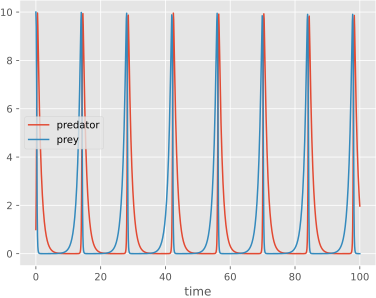

---
hide:
  - navigation
---
# Poincare


<div class="grid cards" markdown>

- { align=left , width="375" } 
```py
import numpy as np
from poincare import *

class LotkaVolterra(System):
    prey: Variable = initial(default=10)
    predator: Variable = initial(default=1)

    prey_eq = prey.derive() << prey * (1 - predator)
    predator_eq = predator.derive() << predator * (prey - 1)

sim = Simulator(LotkaVolterra)
sim.solve(save_at=np.linspace(0, 100, 1000)).to_dataframe().plot()
```
</div>
<div style="text-align:center;"> <i><a href="https://en.wikipedia.org/wiki/Lotka%E2%80%93Volterra_equations">Lokta-Volterra</a> predator-prey model implemented in Poincare. </i></div>

Poincare is a python library for declaring and simulating dynamical systems. It's designed around:

- __Modularity__: Poincare creates a layer to separate the actual declaration and simulation of models, allowing to easily switch between methods and compile to different backends (including [NumPy](https://numpy.org/), [Numba](https://numba.pydata.org/) and [JAX](https://docs.jax.dev/en/latest/)).
- __Composability__: models are composable, allowing for the combination of smaller systems to create larger ones; complex models can be broken up into more manageable parts.
- __Reproducibility__: it intends to be a centralized place for all information concerning models, making it easy to extract data (equations, parameters, etc...) and encouraging consistency between analytical formulations and numerical implementations.
- __Utility__: Poincare includes a number of utilities to make model analysis more convenient, including searching for steady states, bistability or limit cycles across a range of parameter values.

---
## Installation 

It can be installed from PyPI:

```sh
pip install -U poincare
```

or conda-forge:

```sh
conda install -c conda-forge poincare
```

### Agent skill

Poincare ships with the `dyscolab-modeling` agent skill, which teaches coding agents how to use Poincare, SimBio and Jablonski. It is downloaded with the library, but has to be added to your agent's skills folder separately.

In pixi projects, link it with [pixi skills](https://pixi.prefix.dev/dev/integration/extensions/pixi_skills/), so it updates together with the library:

```sh
pixi global install pixi-skills                   # once
pixi skills manage --backend claude --scope local  # or another agent's backend
```

In any other environment, copy it with the environment's Python, and run the command again after upgrading the library:

```sh
python -m poincare.skill install --dest .agents/skills   # or .claude/skills, ~/.codex/skills, ...
```

See [Agent skills](skills.md) for more details.

---
## Documentation
Documentation is structured as a series of interactive [marimo](https://marimo.io/) notebooks which cover basic and advanced topics. They can be ran in the browser either in a static or interactive version or by cloning the [dyscolab-tutorials](https://github.com/dyscolab/dyscolab-tutorials) repository to open them locally. 
### Basics
- **Getting started with Poincare**: the essentials necessary to simulate models. [Interactive](https://marimo.app/https://github.com/dyscolab/dyscolab-tutorials/blob/main/poincare/getting_started_with_poincare.py) / [Static](static_notebooks/getting_started_with_poincare.html)
- **Composition**: how to combine smaller models to create more complex ones, one of Poincare's key features. [Interactive](https://marimo.app/github.com/dyscolab/dyscolab-tutorials/blob/main/poincare/composing.py) / [Static](static_notebooks/composing.html)
- **Simulators**: more on how configure the simulation, including switching methods and backends. [Interactive](https://marimo.app/github.com/dyscolab/dyscolab-tutorials/blob/main/poincare/simulation.py) / [Static](static_notebooks/simulation.html)
### Topic guides
- **Asymptotic behaviour and parameter sweeps**: characterize the asymptotic behaviour of the system, including the search for steady states, bistability and limit cycles, across a range of parameter values. [Interactive](https://marimo.app/github.com/dyscolab/dyscolab-tutorials/blob/main/poincare/asymptotic_behaviour.py) / [Static](static_notebooks/asymptotic_behaviour.html)
- **Fitting models to data**: fit parameters and initial conditions to measured time courses or steady states with `fit_result`, `fit_steady_state` and `Fitter`, including fitting several experiments at once with shared parameters. [Interactive](https://marimo.app/github.com/dyscolab/dyscolab-tutorials/blob/main/poincare/fitting.py) / [Static](static_notebooks/fitting.html)
- **Units**: use physical units from [pint](https://github.com/hgrecco/pint) in variables, parameters and simulation times, and get results that carry the corresponding units. [Interactive](https://marimo.app/github.com/dyscolab/dyscolab-tutorials/blob/main/poincare/units.py) / [Static](static_notebooks/units.html)

---
## GitHub
Poincare is developed in it's [github repo](https://github.com/dyscolab/poincare).
